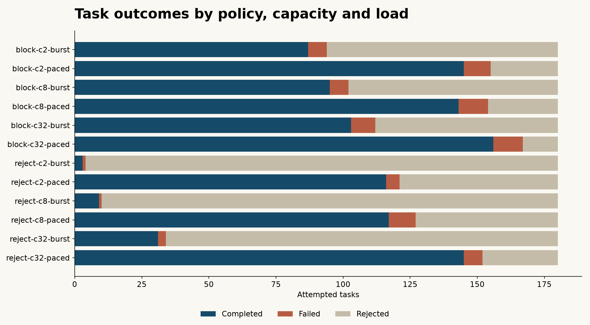

# Java backpressure lab

A Java 21 study of bounded work queues, overload admission and graceful worker shutdown. The queue implementation, concurrent tests and workload runner use only the JDK. Python turns actual Java task traces into charts and a static report.



This is an AI-assisted portfolio exercise with synthetic workloads. The recorded results are local measurements, not production throughput claims. There is no network traffic or external service dependency.

## Inspect the project

- [Static report](docs/report.html): open locally in a browser.
- [Measured findings](results/findings.md) and [summary CSV](results/summary.csv).
- [Raw per-task timestamps and occupancy observations](results/raw/).
- [Queue implementation](src/lab/BoundedPipeline.java), [lifecycle tests](src/lab/PipelineTests.java) and [independent concurrency tests](src/lab/PipelineReviewTests.java).
- [Design and API contract](docs/design.md), [correctness evidence](docs/correctness.md) and [measurement protocol](docs/measurement.md).
- [Report screenshots](docs/screenshots/README.md) and [continuous report review recording](docs/recordings/README.md).

## What it implements

`BLOCK` waits for queue capacity with a condition-wait budget. `REJECT` rejects a full queue after obtaining the state lock. Both policies reject after closure and preserve an interrupted submitting thread's interrupt status. A nonfair `ReentrantLock` serializes queue and task-state changes.

Closing begins a drain; it does not interrupt running tasks. Queued work can be cancelled explicitly. Ordinary task failures are recorded and workers continue. Every valid unique submission has one owner and an observable outcome. Duplicate IDs are validation errors and do not create additional attempts.

The waiting queue is bounded. Running tasks, waiting producer threads and the retained task-history map are separate resources; this is not a constant-memory general-purpose executor. Catching task `Throwable` does not guarantee recovery from VM failure or resource exhaustion.

## Reproduce

Install a JDK 21 with `java` and `javac` on PATH, and Python 3.13. The committed run used Temurin 21.0.12.1 on Windows; see [environment metadata](results/raw/environment.json).

```sh
python -m pip install -r requirements.txt
python scripts/run_study.py --output-dir build/my-run
python -m unittest discover -s tests -v
```

The driver compiles the Java sources with `--release 21`, runs both Java test suites, runs 12 finite workload configurations, checks task accounting, and writes charts, raw data and `build/my-run/docs/report.html`. It uses bounded process timeouts. `--quick` reduces each producer from 60 to 20 tasks; timing and admission results vary with the host and scheduler. Run without `--output-dir` to replace the committed report and results. `--reuse` only replots existing raw measurements in the selected output directory and reruns tests; use it only when the Java measurement sources have not changed.

To run just the Java tests, without Python dependencies:

```sh
javac --release 21 -d build/classes src/lab/BoundedPipeline.java src/lab/PipelineTests.java src/lab/PipelineReviewTests.java src/lab/PipelineStudy.java
java -cp build/classes lab.PipelineTests
java -cp build/classes lab.PipelineReviewTests
```

CI validates the committed raw evidence and runs a fresh quick Java study into `build/ci`, preserving the original measurements.

## Reading the results

The matrix compares two policies, queue capacities 2/8/32, and burst/paced producers. Each scenario uses two workers and three producers. Tasks perform integer arithmetic, request a minimum two-millisecond parked delay, and fail for admitted IDs divisible by 17. These are intentionally synthetic failure and service conditions.

Compare rejection counts with latency. A policy can have lower completed-task latency because it admits fewer tasks. Successful completion rate divides `COMPLETED` tasks by producer-release-to-worker-drain elapsed time. This single-trial, fixed-order study has JIT, scheduler, timer and ordering confounders; it is not a JMH microbenchmark or an equal-completed-work comparison.

## Scope

No caller-runs policy, retry, priority scheduling, persistence, crash recovery, forced task cancellation or exactly-once external effects. Worker shutdown waits for admitted tasks to return. The experiment's finite tasks permit bounded cleanup; arbitrary nonterminating user work cannot be stopped safely by this API.
